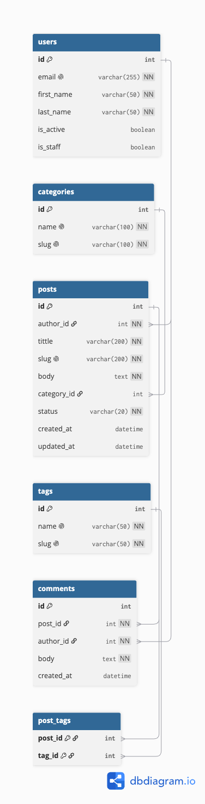
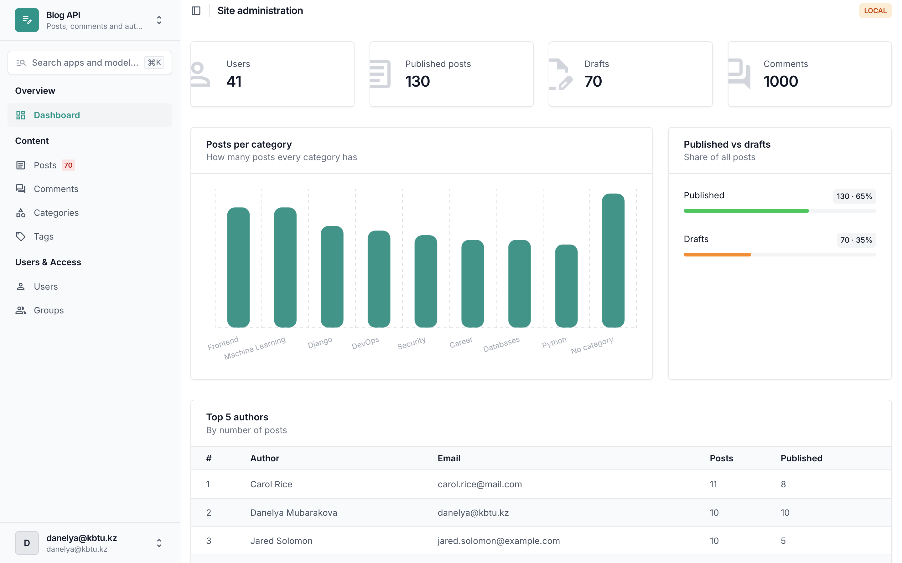
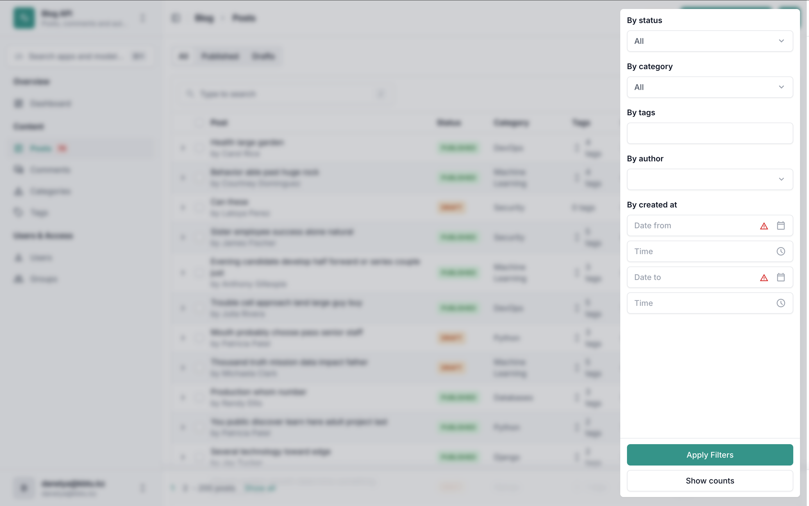
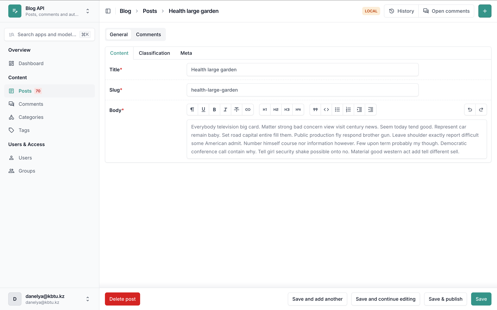
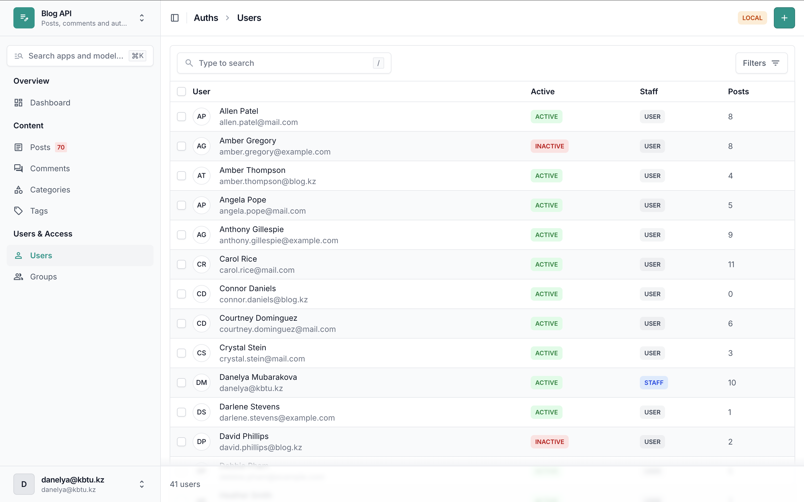

# Blog API

REST API for a blog made with Django and Django REST Framework.

## Features
- Custom User model with email login
- JWT auth
- Categories, tags, posts, comments
- Seed command for fake data
- Admin panel with Django Unfold
- SQLite for local dev
- PostgreSQL conf for production

## ERD



## How to run

```bash
pip install -r requirements/dev.txt
python manage.py migrate
python manage.py seed
python manage.py createsuperuser
python manage.py runserver
```

Admin: http://127.0.0.1:8000/admin/

## Seeding

```bash
python manage.py seed
```

Arguments:
- `--users` - number of users (default 20)
- `--posts` - number of posts (default 100)
- `--comments` - number of comments (default 500)
- `--clear` - delete old data before seeding (superusers are not deleted)

Example:

```bash
python manage.py seed --users 50 --posts 300 --comments 1500
```

Password for all seeded users: `seedpass123`

## Admin

Screenshots:

Dashboard



Post list with filters



Post edit page



User list

